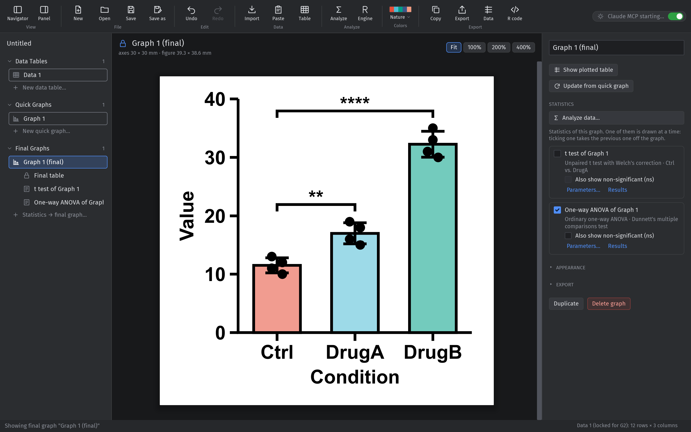
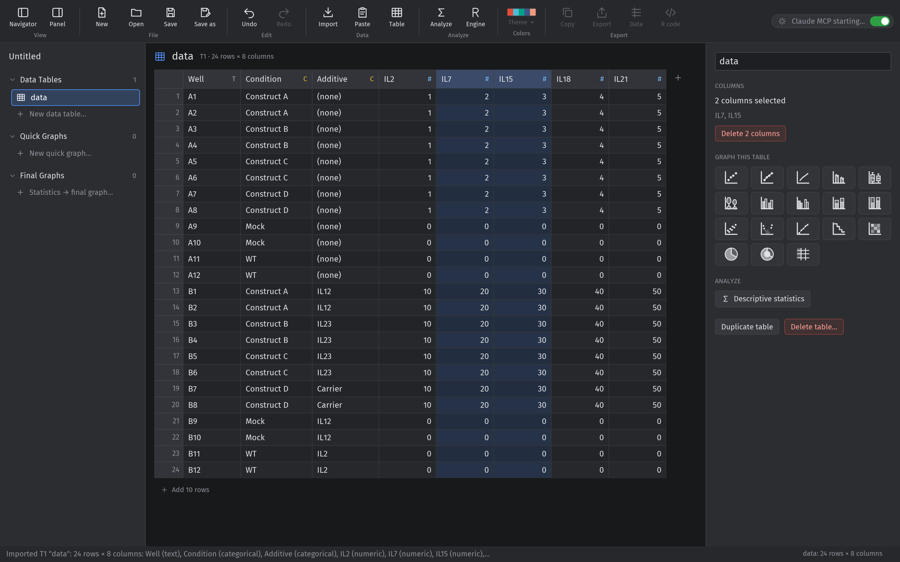
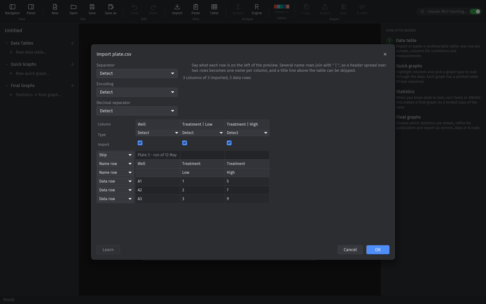

# Otto

[](https://github.com/ds1-ops/Otto---Scientific-Plotting-Software/actions/workflows/ci.yml)
[](LICENSE)

A GraphPad Prism–style plotting app written in Rust: dark UI, publication-ready
vector graphs, and full Claude/MCP integration. Every button is also an MCP
tool, so Claude can build, adjust and export graphs while you watch.

> **Early alpha (0.1), Windows only.** Otto is a working concept rather than
> finished software: expect bugs, and check anything you intend to publish. It
> uses the Win32 API for the clipboard, EMF export and window placement, and finds
> R through the Windows registry, so it does not build or run on macOS or Linux
> today.



Statistics belong to a final graph, which keeps a locked copy of its data, so the
brackets can never drift out of step with the numbers underneath them.



One multivariable table feeds every graph: highlight the columns you want and pick
a graph type.



Importing shows what each row is and what each column would be called, so a title
line, a two-row header or a guessed-wrong separator is sorted out before anything
lands in the table.

## Installing

**If you just want to use Otto**, download the latest
[release](https://github.com/ds1-ops/Otto---Scientific-Plotting-Software/releases):
`otto.exe` runs on its own, and `otto.mcpb` is the Claude Desktop extension.
Nothing else to build.

Statistics additionally need **R** (4.x). Otto finds it through the registry or
under `C:\Program Files\R`, and the first run of any test installs Otto's own R
packages into `~/.otto` from a pinned CRAN snapshot, so every installation
computes with the same versions. Install R from
[CRAN](https://cran.r-project.org) (or `winget install RProject.R`), then open
*Analyze → Statistics engine → Set up*. Everything except statistics works
without R.

**To build from source**, see [Build and run](#build-and-run-vs-code) below.

## How Otto differs from Prism

- **Data is always a multivariable table**: one row per sample, columns for factors
  (condition, genotype, additive) and measurements. Import CSV/Excel or paste from Excel.
  Importing a file opens a wizard: it shows what each row is (name row / data row / skipped)
  and what every column would be called and typed, so a title line above the table, a header
  spread over two rows (joined as `Treatment | Low`), a guessed-wrong separator or a
  Windows-1252 export can be sorted out before anything is imported.
- **Graphs pick columns**: the right sidebar chooses X, Y (one or more) and Group
  columns from the table, plus row filters: the values to keep for a categorical column,
  a range for a numeric one. One table can feed many graphs. The graph type and the
  columns stay open in the sidebar; filters, appearance and export fold away.
- **Bars from several columns**: X and Group by accept several columns; each value
  combination becomes one bar or data set, labelled `A | B` (e.g. construct | additive | well).
  Separated grouped graphs label every bar `X | group`.
- **Fixed publication formats**: square (30 × 30 mm axes), wide (45 × 30 mm) or ultra-wide (60 × 30 mm),
  1 pt lines, Arial Bold 7 pt, no tinkering needed.
- **Exports**: vector graphics to the clipboard (EMF + SVG) or to a file (SVG/PDF/EMF/PNG),
  the plotted subset of the data (CSV, or tab-separated text on the clipboard) and
  equivalent R/ggplot2 code (.txt).

The left navigator follows the workflow from top to bottom. Hovering a data table, graph or result shows a × to delete it: a data table asks first and removes every graph made from it (quick and final), while deleting a graph never touches the data table or the graphs on the other side (Ctrl+Z undoes any of it). Duplicate is in each panel.

| Section | What it holds |
|---|---|
| **Data Tables** | Multivariable tables only. Click headers to highlight columns (Ctrl / Shift for several) and pick a graph type: highlighted numeric columns become the Y values. Double-click a header to rename it; Ctrl+V on a highlighted header pastes a table including its header row (empty columns get their type from the pasted values). |
| **Graphs** | Quick graphs for looking through the data: type, X / Y / Group by, rows, error bars and axes are all set here. They never show statistics. Each lists its **Plotted table** underneath: exactly what it plots in Prism's layout, where each bar (or XY data set) is a block of side-by-side replicate subcolumns, with the bar names in the first row and "replicate 1…n" in the second. It copies and pastes into Prism as is. Read-only, and built only when opened. |
| **Final Graphs** | Made from a quick graph with **Make final graph** (choose statistics) or **without statistics**, at the top of the quick graph. Each final graph lists its **Final table** and its statistics underneath. It keeps a **locked copy** of the data, taken when it was made, so later edits to the data table don't change it. Only its format (square / wide / ultra-wide), axis titles, appearance (colors, legend) and statistics can change, so its statistics always match what it shows. Descriptive statistics appear under their data table. |

### Statistics

**Analyze** opens a Prism-style *Analyze Data* dialog. The analysis tree is on the left; on the
right are the data sets, which are the bars of a graph. OK opens the parameters dialog with
Prism's tabs.

- **t tests**:
  - unpaired (Welch or Student, on raw or log values), paired, ratio paired, Mann-Whitney, Wilcoxon;
  - one- or two-tailed, confidence level, effect sizes, AICc.
- **One-way ANOVA**:
  - tests: ordinary, Brown-Forsythe + Welch, repeated measures (sphericity or
    Geisser-Greenhouse), Kruskal-Wallis, Friedman;
  - follow-up: all pairs (Tukey), vs. control (Dunnett), selected pairs (Šídák),
    Dunnett T3 / Games-Howell, Dunn's, Fisher's LSD or two-stage FDR.
- **Contingency tables**: a `contingency` graph holds the counts (rows = X, columns = Group by or
  several Y columns), and the analysis runs the chi-square test with and without Yates'
  correction, Fisher's exact test, McNemar's test for a paired design and the chi-square test
  for trend; a 2 x 2 table also gets the relative risk, the odds ratio, the difference between
  fractions and the diagnostic ratios (sensitivity, specificity, predictive values).
- **Matched by**: paired and repeated-measures designs pair values through a subject column (e.g. Donor).
- **Results**:
  - listed under their final graph and shown like Prism's results sheets, with GP, APA or NEJM P value styles;
  - significant comparisons are drawn on the graph as **brackets with stars**, and "ns" is optional.
- **On the graph**:
  - statistics are drawn on final graphs only;
  - brackets are stacked above the data without touching each other;
  - the graph itself is unchanged: the Y axis and bar sizes stay the same, and the figure grows upward;
  - the final graph's panel (*Statistics*) lists its analyses, so you tick which ones are drawn.
- **Always consistent**:
  - a final graph's data and what it plots are fixed, so its statistics can't fall out of step;
  - as a safety net (e.g. a project file edited outside Otto), statistics that no longer match are hidden, with options to recalculate or set them up again.

### Graph types

| Kind (MCP name) | X | Y | Group |
|---|---|---|---|
| XY points (`xy_points`) | numeric | numeric | optional |
| XY points + line (`xy_points_line`) | numeric | numeric | optional |
| Column bar + points (`column_bar`) | categorical (or none: one bar per Y column) | numeric | – |
| Grouped, interleaved (`grouped_interleaved`) | categorical | numeric | yes, or several Y columns |
| Grouped, separated (`grouped_separated`) | categorical | numeric | yes, or several Y columns |
| Stacked bars (`stacked_bar`) | categorical | numeric | yes, or several Y columns |
| Stacked bars, 100% (`stacked_percent`) | categorical | numeric | yes, or several Y columns |
| Scatter (`xy_scatter`) | numeric | numeric | optional |
| XY line only (`xy_line`) | numeric | numeric | optional |
| Box and whisker (`box`) | categorical | numeric | – |
| Violin (`violin`) | categorical | numeric | – |
| Heatmap (`heatmap`) | categorical | numeric | rows, or several Y |
| Volcano (`volcano`) | log2 fold change | P value | – |
| Normal QQ (`qq`) | – | numeric | optional |
| Kaplan-Meier (`survival`) | time | event (1/0) | one curve per group |
| Pie (`pie`) | categorical (slices) | numeric (summed) | – |
| Donut (`donut`) | categorical (slices) | numeric (summed) | – |
| Contingency table (`contingency`) | categorical (rows) | numeric counts (columns) | columns, or several Y |

## Build and run (VS Code)

Prerequisites: Windows, Rust (stable, MSVC toolchain, 1.85 or newer) and VS Code
with the recommended extensions (rust-analyzer, C/C++ for debugging). R is needed
only for the statistics; without it the tests that compute skip themselves with a
note instead of failing.

```bash
cargo run -p otto-app -- data/data.xlsx
```

- **Run/debug:** use *Run and Debug → Otto app*. Tasks: *Otto: build / test / clippy / graph gallery*.
- **Tests:** `cargo test --workspace`. The plot tests also write every graph type to
  `target/otto-gallery/` (SVG, PNG, PDF, EMF, CSV and R code) for visual review.

## Connecting Claude (MCP)

Otto exposes 85 tools (`project_*`, `table_*`, `graph_*`, `analysis_*`, `ui_*`). The
binary has a stdio entry point, `otto mcp`:

- If the Otto app is running, `otto mcp` bridges to it, so Claude's changes appear live in the window.
- Otherwise it runs a headless engine (`otto mcp --headless` forces this).

**Claude Code** (from any folder):

```bash
claude mcp add otto -- "C:\path\to\Otto\target\debug\otto.exe" mcp
```

This repo also has a project-scoped `.mcp.json`, so Claude Code started in `Otto/` picks it up.
It goes through `scripts/otto-mcp.cmd`, which runs the server from its own copy under
`target/mcp/`: a running server locks the file it was started from, so starting it directly
from `target/debug/otto.exe` makes `cargo build` fail to link while Claude is connected.
Each server copies the current build, so reconnect after a rebuild to pick up new tools.

**Claude Desktop**: install Otto as an extension, like any other Claude extension.

1. Build the bundle (it contains its own `otto.exe`, so Claude never locks your development builds):
   ```bash
   powershell -ExecutionPolicy Bypass -File packaging\build-extension.ps1
   ```
2. Install `dist\otto.mcpb`: double-click it, or in Claude Desktop go to *Settings → Extensions →
   Advanced settings → Install extension*. It then appears under *Settings → Extensions*, with an on/off toggle.
3. Open Otto, switch on **Claude MCP** (top right), then start or restart Claude Desktop.

After updating Otto, rebuild the bundle and install it again to give Claude the new tools.

The running app also serves MCP over HTTP at `http://127.0.0.1:47800/mcp`. It only
accepts localhost and requires a bearer token, which is stored in `~/.otto/mcp.json`
(not under `%APPDATA%`: Claude desktop is a packaged app, and a packaged process writing
there gets a private copy inside the package, so the bridge and the window would end up
reading different files). Only one window serves Claude: a second one says so instead of
taking the endpoint over.

**Claude MCP switch** (top right of the window; the choice is remembered in `%APPDATA%\Otto\settings.json`):

- **Off**: the app stops its MCP endpoint and removes `mcp.json`, so Claude can't see or change the window.
- **While off**: a connected `otto mcp` bridge answers Claude that access is switched off.
- **On again**: the bridge reconnects by itself.
- **Starting while off**: an `otto mcp` started while the app is off (or closed) runs headless, with its own project.

Example prompt: *"Import data/data.xlsx, make a grouped interleaved bar graph of IL2 by
Condition grouped by Additive in the wide format, show it to me, then export it as SVG
and the plotted data as CSV to my Desktop."*

## Architecture

```
crates/
  otto-core    data model (typed columns), CSV/XLSX/paste import, graph specs, .otto files
  otto-r       statistics engine: R in a persistent worker (tests, ANOVA, fits); setup
  otto-plot    distill → layout → scene → SVG / PDF / PNG / EMF; data export; R code
  otto-engine  Command enum = every user action; Engine with undo/redo; clipboard
  otto-mcp     MCP server generated from the command registry (stdio, HTTP, bridge)
  otto-app     iced GUI (binary `otto`)
```

The GUI only changes state by sending `otto_engine::Command`s, and the MCP tool list is
generated from the same registry. A new command is therefore automatically both a UI
action and a Claude tool. A test asserts that the two lists are identical.

Adding a graph type means: a new `GraphKind` variant (otto-core), a layout case in
`otto-plot/src/draw.rs` and a template in `rcode.rs`. The UI and MCP pick it up automatically.

## Examples

[`examples/`](examples/) holds seven synthetic experiments, the Otto project built
from them and what it exported: vector graphs, the plotted data and the equivalent
R code. `data/` holds the smaller tables the tests and the app's own example project
use. Neither contains real measurements.

## License

MIT, see [LICENSE](LICENSE).

Otto lays out what R computes. The statistics come from R and its packages, which
carry their own licenses, and Otto installs them into its own library rather than
bundling them.
